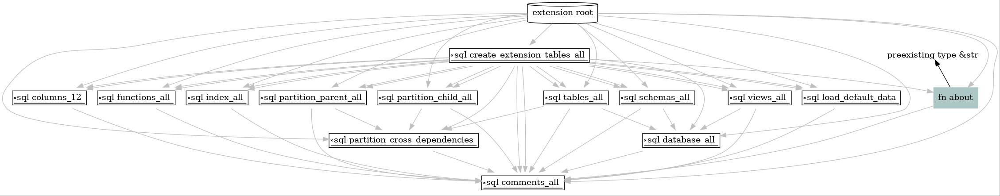

# Create Installer


This page covers two methods that can be used to build binary installers
for PgDD. This documents how the pre-built binaries are provided for each versions
and explains how end users can extend this to their operating systems and
architectures.

The two methods that can be used to build binaries are the Docker build system
and manually installing and using `pgrx`.
PgDD's installers are specific to three (3) details:

* CPU Architecture
* Operating System version
* Postgres version


## Architecture supported

Project maintainers currently only provide pre-built installers for the AMD architecture.
This matches the hardware easily available.


## Operating Systems Supported

The Docker build targets the following operating systems.

* Ubuntu 24.04
* Ubuntu 22.04
* Debian 13 (the PostGIS image)


## Docker Build System

The Docker build method uses OS specific `Dockerfile` to provide one binary
installer for each supported Postgres version.  The CPU architecture it is
built for matches the hardware building the installer.
The Docker build system is the best approach to use when the appropriate
`Dockerfile` already exists.


> The Docker build method was originally based on [ZomboDB's build system](https://github.com/zombodb/zombodb).

To generate the full suite of binaries change into the `./build` directory
and run `build.sh`. This builds an installer for each operating system
and PostgreSQL major (15 through 19).

```bash
cd build/
time bash ./build.sh
```

Individual installers can be found under `./target/artifacts`.  A package of
all installers is saved to `./build/pgdd-binaries.tar.gz`.

> Tagged versions of PgDD include LTS OS binaries with their [release notes](https://github.com/rustprooflabs/pgdd/releases).


### Customize Docker Build system

The Docker build system can be adjusted locally to build a binary for
a specific Postgres version and/or specific OS.

The `./build/build.sh` script has the logic to be adjusted to control this.
The Postgres versions can be  altered manually by commenting out the line
with all versions and uncommenting the line with a specific Postgres version.
The two lines in the script are shown below.

```bash
PG_VERS=("pg15" "pg16" "pg17" "pg18" "pg19")
#PG_VERS=("pg19")
```


To only build for Postgres on a single OS, add a `grep <osname>` command to the
loop logic.  The original file that runs for all OSs with Dockerfiles looks like
the following line.

```bash
for image in `ls docker/ ` ; do
```

To build for only `noble` (Ubuntu 24.04) add ` | grep noble ` as shown in the
following example.

```bash
for image in `ls docker/ | grep noble ` ; do
```

### Operating Systems supported


Pull requests are welcome for new Dockerfiles to add support for additional operating
systems. These PRs should operate in a similar manner (where possible) to
existing `Dockerfile` for easiest maintenance. 

 

----

## Create Binary Installer w/out Docker

The following steps walk through creating a package on a typical
Ubuntu based system with Postgres 15.  These manual instructions can be used
when you do not want to use the Docker based build system under `./build/`.


### Prerequisites

The main perquisites for PgDD are `pgrx` and its dependencies.
Install prereqs and ensure PostgreSQL dev tools are installed.

> See the [cargo pgrx](https://github.com/pgcentralfoundation/pgrx/tree/master/cargo-pgrx)
documentation for more information on using `pgrx`.


```bash
sudo apt install postgresql-server-dev-15 libreadline-dev zlib1g-dev curl \
    libssl-dev llvm-dev libclang-dev clang \
    graphviz
```

[Install Rust](https://www.rust-lang.org/tools/install) and pgrx.

```bash
curl https://sh.rustup.rs -sSf | sh -s -- -y
source $HOME/.cargo/env
```

Use Rust 1.99.1 or later and install the version of `cargo-pgrx` that matches PgDD.


```bash
cargo install --locked cargo-pgrx --version 0.20.1
```


Install `cargo-deb` used for packaging binaries.

```bash
cargo install cargo-deb
```


Point `cargo-pgrx` at the PostgreSQL 15 installation used in this example.

```bash
cargo pgrx init --pg15 /usr/lib/postgresql/15/bin/pg_config --no-run
```


The `fpm` step requires the `fpm` Ruby gem.

```bash
sudo apt install ruby-rubygems
sudo gem i fpm
```

Of course, the PgDD project itself is required.

```bash
mkdir ~/git
cd ~/git
git clone https://github.com/rustprooflabs/pgdd.git
cd ~/git/pgdd
```

### Create package

> Timing note:  `cargo pgrx package` takes ~ 2 minutes on my main dev machine.


```bash
cargo pgrx package --no-default-features --features pg15 --pg-config /usr/lib/postgresql/15/bin/pg_config
cd target/release/pgdd-pg15/

find ./ -name "*.so" -exec strip {} \;
OUTFILE=pgdd.deb
rm ${OUTFILE} || true
fpm \
  -s dir \
  -t deb -n pgdd \
  -v 0.5.0 \
  --deb-no-default-config-files \
  -p ${OUTFILE} \
  -a amd64 \
  .

sudo dpkg -i --force-overwrite ./pgdd.deb
```


## pgrx Generate graphviz

```bash
cargo pgrx schema -d pgdd.dot
dot -Goverlap=prism -Gspline=ortho -Tjpg pgdd.dot > docs/src/pgdd.jpg
```




## Non-standard dev

When working against pgrx installed from a non-tagged branch, install pgrx using:

```bash
cargo install --locked --force --git "https://github.com/tcdi/pgrx" \
    --branch "develop" \
    "cargo-pgrx"
```


The following command can be used to force pgrx to overwrite the configs it needs to
for various dev related changes.

Clean things out.

```bash
cargo clean
```

If you're doing the above, you probably should remove the `Cargo.lock`
file while you're at it.  The more cautious may want to move it aside for a backup.

```bash
rm Cargo.lock
```

Force build the schema.


```bash
cargo pgrx schema -f
```


## Non-standard In Docker

If testing this extension against non-standard pgrx install, update the
Dockerfile to install from the specific branch.

Change

```bash
RUN /bin/bash rustup.sh -y \
    && cargo install --locked cargo-pgrx --version ${PGRXVERSION}
```

To

```bash
RUN /bin/bash rustup.sh -y \
    && cargo install --locked --force --git "https://github.com/tcdi/pgrx" \
        --branch "develop" \
        "cargo-pgrx"
```

